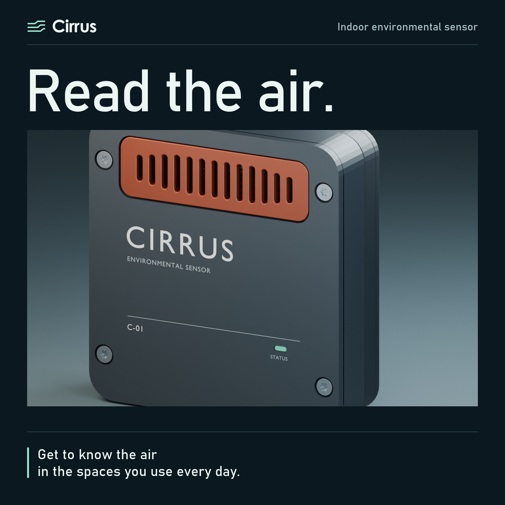
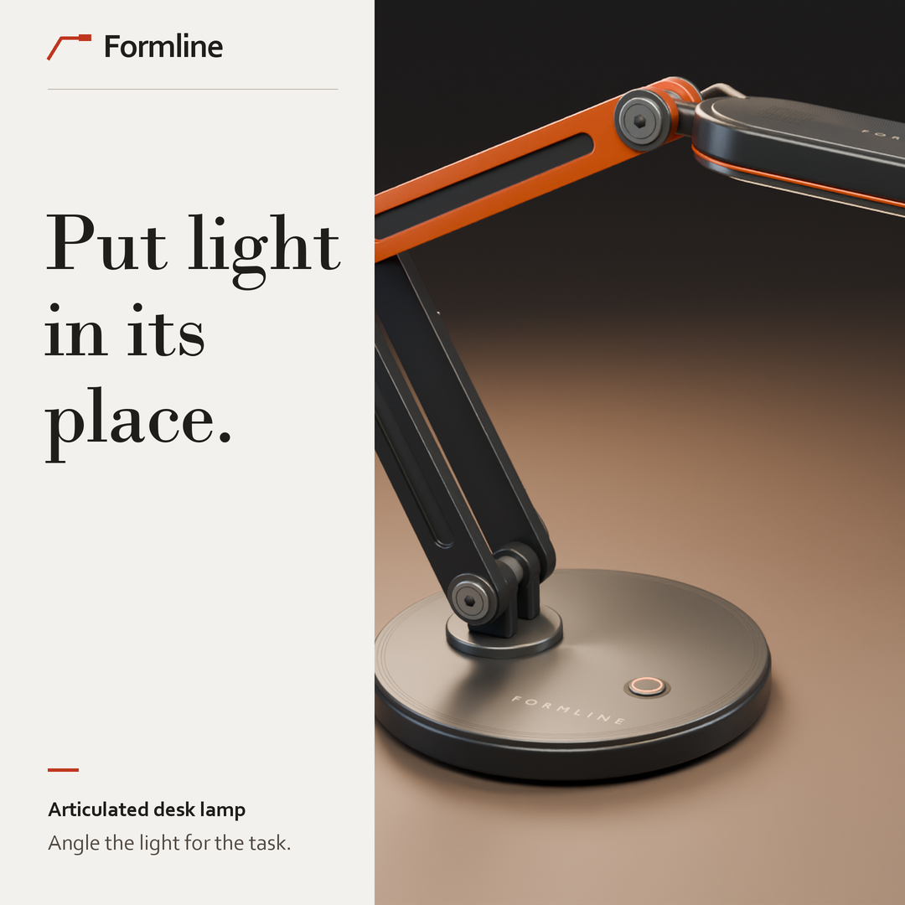
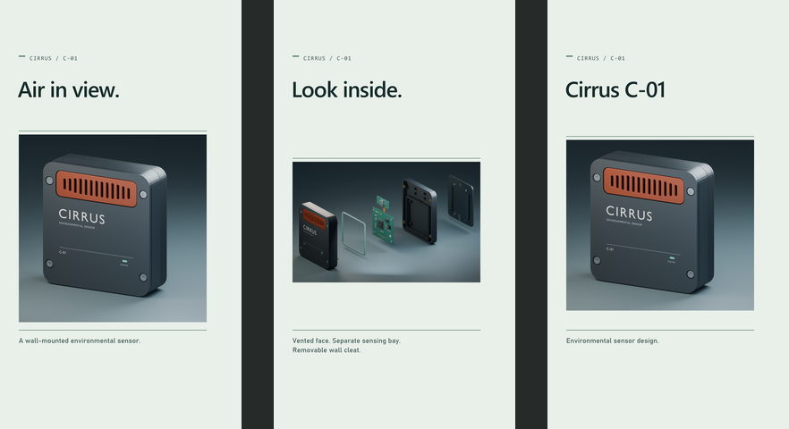
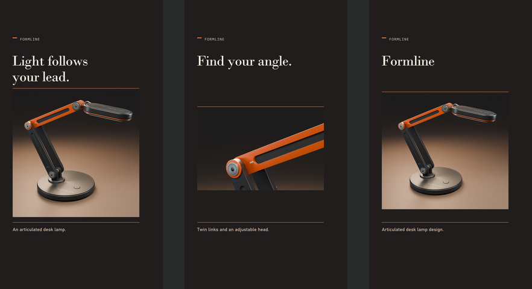

# Cirrus and Formline product campaigns

Product advertising and art direction for two industrial design projects. Each campaign uses original Blender renders in a 1080 × 1080 square placement, a separately composed 1080 × 1350 portrait placement, and a seven-second 1080 × 1920 story edit.

 

## Cirrus

**Air in view.** A pale green layout frames the complete wall-mounted sensor. The portrait pairs its front face and mounting details with a full exploded assembly.

[Square placement](exports/cirrus-square.png) · [Portrait placement](exports/cirrus-vertical.png) · [Blender project](https://github.com/muhammmmadziam1234-eng/cirrus-environment-sensor)

## Formline

**Light follows your lead.** Warm studio lighting shows the full lamp silhouette. The portrait places a joint close-up below the complete product to show how the lamp articulates.

[Square placement](exports/formline-square.png) · [Portrait placement](exports/formline-vertical.png) · [Blender project](https://github.com/muhammmmadziam1234-eng/formline-articulated-lamp)

## Vertical story edits

| Cirrus · Air in view | Formline · Light follows your lead |
| --- | --- |
| [Watch the seven-second MP4](exports/cirrus-story.mp4) · [Opening poster](exports/cirrus-story-poster.png) | [Watch the seven-second MP4](exports/formline-story.mp4) · [Opening poster](exports/formline-story-poster.png) |
|  |  |

The edit gives the viewer the whole product first, then a detail worth pausing on: the Cirrus sensing bay and wall cleat, or the Formline pivot and twin links. The last shot returns to the product name. Each story is designed to play silently. Type is held inside generous top and bottom margins, with the right edge kept clear for platform controls. Check the placement preview in the target app before publishing.

## Editable source and export

[render_ads.py](render_ads.py) contains the layout, text, colors and crop settings. The source renders are included in [assets](assets). The exporter uses Pillow and locally installed fonts with system font fallbacks.

~~~sh
python -m pip install -r requirements.txt
python render_ads.py
python render_stories.py
~~~

Use `--campaign cirrus` or `--campaign formline` to export one family. `--cirrus-dir` and `--formline-dir` accept alternate render folders. The default output is `exports`, where the four sRGB PNGs are saved.

[render_stories.py](render_stories.py) contains the story copy, shot timing, crop animation, and per-video decode check. It exports H.264 MP4 at 24 fps with the storyboard and poster PNGs.
